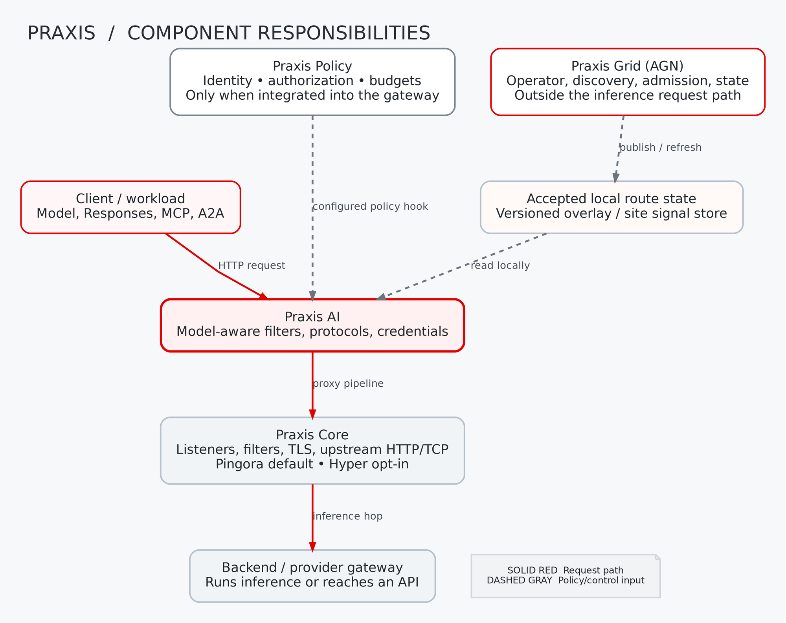
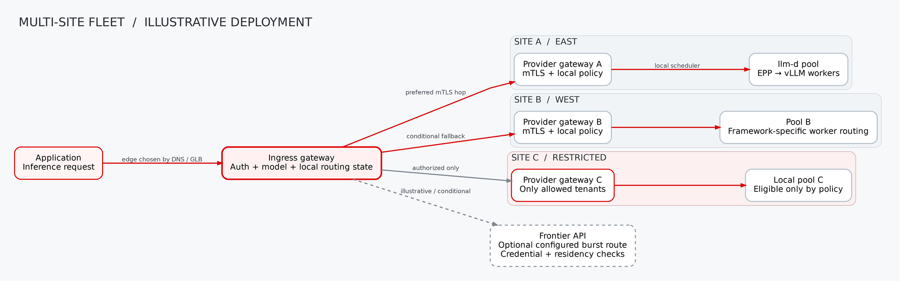
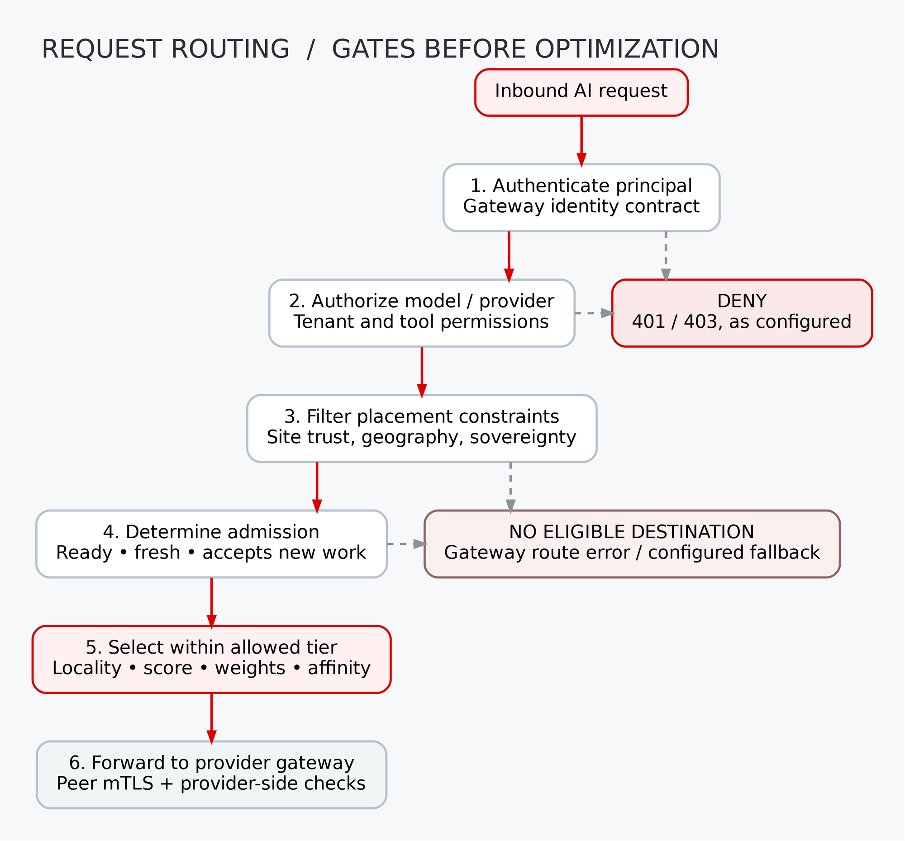
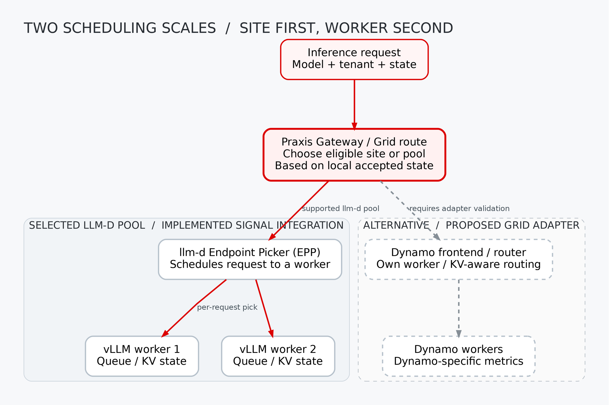
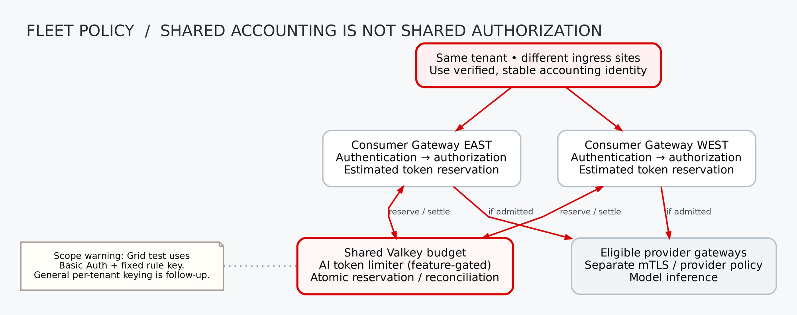
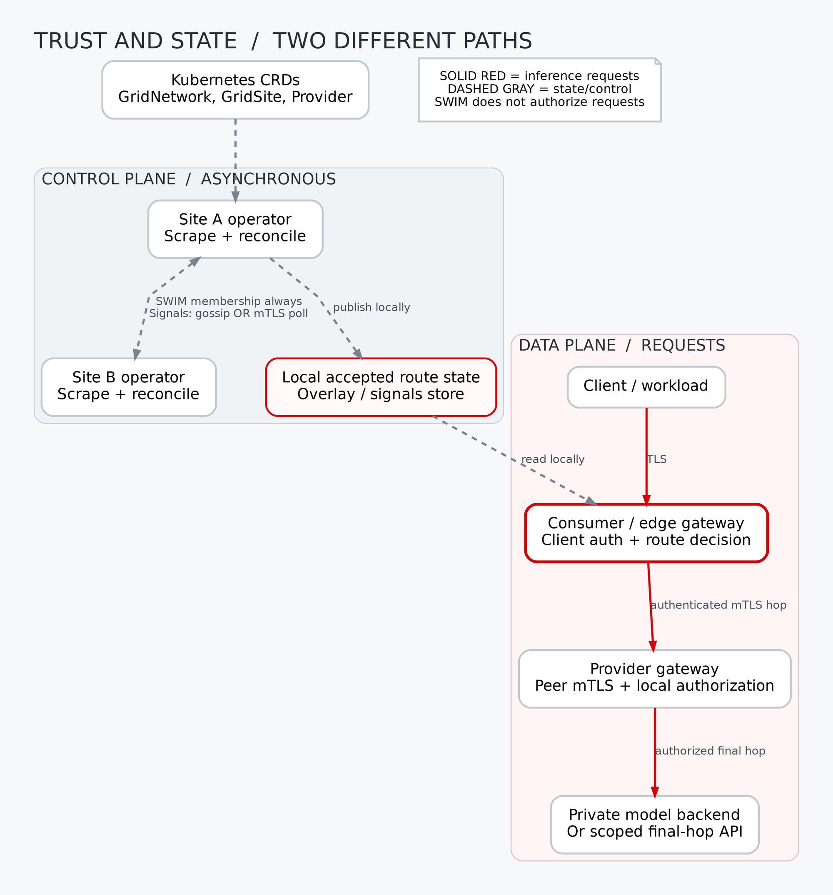
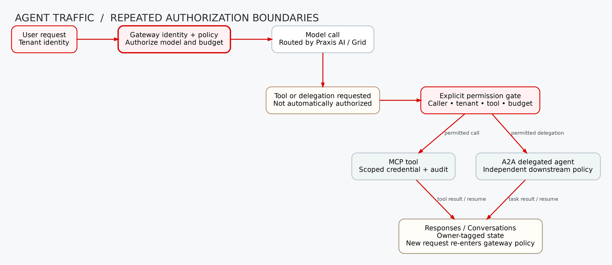

# Praxis Grid: Routing AI Inference Across Sites Without Losing the Plot

It's been a while since I wrote a blog post. Apparently, the best way to correct that is to pick a subject involving multiple control planes, GPU memory, and distributed systems. A modest re-entry.

Suppose an application calls an AI inference gateway for a model that runs in three Kubernetes clusters. One cluster is close to the caller, another has spare capacity, and a third is inside a geography the tenant must never use. The application may also be continuing an earlier conversation, and the first two clusters may have very different amounts of reusable KV cache. A successful TCP connection answers almost none of the interesting questions.

This is the problem **Praxis Grid**—the AI Grid Network, or AGN—works on: **distributed inference routing** across sites while preserving routing and trust boundaries. The requests travel through Praxis, a programmable **Rust proxy** and AI gateway. Grid prepares the state that helps the gateway select an eligible destination; it does not become a second HTTP proxy in the request path. That separation is especially useful when **LLM load balancing** crosses regions, operating teams, and infrastructure types. It is also a prerequisite for genuinely **secure multi-region inference** rather than merely multi-region networking.

The interesting part isn't finding *a* working endpoint. It's finding one the caller may use, that accepts this kind of work, and that offers a sensible tradeoff among locality, load, state, and failure risk.

*Figure 1 — Four related projects, four different jobs. Grid informs routing; the gateway carries the request.*

## First, the Praxis family

**[Praxis Core](https://github.com/praxis-proxy/praxis)** provides the network-facing proxy framework: listeners, HTTP/TCP processing, upstream clusters, TLS, health checks, retries, observability, and an ordered filter pipeline. Request filters can choose routes, authenticate traffic, rewrite metadata, or short-circuit processing. The response moves back through response-phase hooks. The configuration can build reusable chains for different listeners, and compatible changes can update the running pipeline without stopping in-flight requests. Think of it as the programmable transport and request-processing foundation, not as an LLM scheduler.

Its default network backend uses **[Cloudflare's Pingora](https://github.com/cloudflare/pingora)**, through Praxis's adapter and a [temporary Praxis Pingora fork](https://github.com/praxis-proxy/pingora) identified in the core Cargo manifest. Pingora brings mature proxy-oriented primitives; Praxis contributes the surrounding filter architecture, configuration model, and integrations. Those are different layers and shouldn't be conflated.

There's also an interesting second backend: **Hyper**, not an unnamed replacement for Pingora. The opt-in `hyper` Cargo feature selects a Hyper 1.x / Tokio / tokio-rustls HTTP implementation instead of default `pingora`. The features are mutually exclusive. It shares much of the Praxis filter, admin, TLS configuration, and health machinery, but the [backend parity document](https://github.com/praxis-proxy/praxis/blob/2212314b12a4536774f41ed4e1aec1619d403459/docs/architecture/hyper-backend.md) names real differences: response compression, upgrade handling, request trailers to HTTP/1 upstreams, TLS health probes, and shutdown sequencing, among others. Hyper has dedicated CI and conformance targets, and its documented gaps should be evaluated before choosing it over the default Pingora path.

**[Praxis AI](https://github.com/praxis-proxy/ai)** adds model-aware behavior to that proxy: model and protocol extraction, provider selection, credential injection, protocol translation, token usage processing, Responses and Conversations state, plus MCP and A2A-oriented filters. It owns the application-visible inference request. For example, the [`intelligent_route` filter](https://github.com/praxis-proxy/ai/blob/3c08a9a63b80d128693732166169d01dc820199c/docs/filters/intelligent_route.md) consumes candidate configuration and can select a provider gateway from an accepted routing snapshot.

**[Praxis Policy](https://github.com/praxis-proxy/policy)** is a separate policy engine and integration surface for identity, authorization, delegation, request controls, and auditing. A decision about *who* can invoke a model or tool is not equivalent to the routing choice about *where* to send an already-authorized operation. The Policy engine can participate through a configured Praxis filter; deploying Grid alone does not magically install tenant authorization everywhere.

Finally, **[Praxis Grid](https://github.com/praxis-proxy/grid)** coordinates the fleet. Its Kubernetes operator watches resources, collects provider state, exchanges information with trusted peers, and prepares routing configuration for the gateways. The project also includes a Grid-specific gateway implementation and site-selection filter. Its operating principle is that **control-plane reconciliation may be asynchronous; request-time decisions should use accepted local state**.

Why use Praxis instead of Envoy? For teams building deeply customized Rust filter logic and wanting a smaller, code-centric integration surface, Praxis can be an appealing fit. You can compose a purpose-built binary instead of designing everything around a large general-purpose extension ecosystem. But [Envoy](https://www.envoyproxy.io/docs/envoy/latest/intro/arch_overview/operations/dynamic_configuration) has a mature service-proxy ecosystem, extensive protocol support, established xDS control-plane patterns, and substantial operational experience. Praxis's design choices may simplify a particular deployment; they don't establish a universal performance, security, or feature-parity advantage. Measure the concrete workload and account for the infrastructure you would otherwise get from Envoy and its surrounding ecosystem.

## A fleet is not a load-balancer pool

For the rest of this article, imagine three sites. East hosts a local **llm-d** inference pool. West has another model-serving pool, perhaps also using llm-d. Europe hosts restricted capacity available only to authorized tenants. There may also be a frontier-model API available as an explicitly configured overflow destination.

*Figure 2 — An illustrative deployment, not a claim that every route or provider integration is built in.*

The first decision might happen *before* Praxis sees the request: a DNS, Anycast, or global traffic manager selects a healthy ingress gateway. Grid does **not** replace that external ingress layer. At the selected edge, the gateway checks identity and request policy, selects an eligible destination from local routing state, and forwards to an authorized provider gateway or configured direct API destination. The provider gateway performs its own peer and provider-side checks before contacting a private backend.

These sites aren't interchangeable just because they all answer `/health`. A ready pool can have a long waiting queue. A pool with low queue depth can be saturated in another resource. And a pool with space to decode may be an expensive choice if a different pool has the prompt already in its KV cache.

A practical routing conversation starts with six questions, in order:

1. **Who is calling, and is this operation authorized?** Authentication establishes a principal; authorization must check its permissions.
2. **Which models and providers can that principal use?** A route cannot expand the caller's rights.
3. **Which sites satisfy placement restrictions?** Residency, geography, and provider access are eligibility constraints, not optional score bonuses.
4. **Which eligible destinations admit new work?** Health and admission state are different signals.
5. **Which admitted choice best fits the request?** Only now should locality, load, affinity, and chosen selection strategy influence preference.
6. **What if the world changes mid-flight?** The system needs explicit behavior for stale signals, withdrawal, retry, and stateful continuation.

*Figure 3 — The policy gates are upstream of the optimization problem. A full but forbidden site is still forbidden.*

## What Grid actually knows about load

Grid supports several routing paths, and their distinctions matter. In the **operator-generated overlay / Praxis AI `intelligent_route` path**, `GridNetwork` specifies a routing policy such as `geographyFirst` or `scoreFirst`, a selection mode such as deterministic, round-robin, random, or weighted random, and—if configured—one provider-pool scoring strategy. The documented scoring strategies are `noMetrics` (default), `queueDepth`, and `kvCachePressure`.

`geographyFirst` builds locality-based priority groups: close providers compete first and remote groups become fallback. `scoreFirst` permits fresh providers across sites to compete in the same group. **Groups define who competes; the picker defines how the winner is selected.** For example, `weightedRandom` with static capacity weights distributes new selections *inside the active group*; weights are not a single global traffic percentage across all fallback tiers. With a deterministic picker, a changing score can reorder candidates, but the gateway still picks the first candidate in that group. [The routing guide](https://github.com/praxis-proxy/grid/blob/427fe3e602417623cf395ee223c224a8e5e95dcd/docs/routing.md) spells out those contracts.

In that overlay path, `queueDepth` means a **pool-level normalized queue**—not a per-request measurement of all workers. `kvCachePressure` prefers **free cache capacity** with a score equivalent to `1 − utilization`, not a proof that this particular prompt's prefix is present. The operator reads configured Prometheus exposition from the provider's metrics endpoint, often an llm-d Endpoint Picker Plugin (EPP). `metricsConfig.signalNames`, `poolName`, and `queueCapacity` control mapping, filtering, and normalization. The names are configurable because EPP versions need not export identical names. Both signals are distinct from inference latency or price, and the public `GridNetwork` scoring API is **not** a configurable blend of all conceivable signals.

The newer **Grid-serving gateway `grid_site_route` path** uses a richer cross-site signal contract. Its llm-d EPP adapter recognizes series such as `llm_d_epp_average_running_requests`, `llm_d_epp_average_queue_size`, `llm_d_epp_ready_endpoints`, `llm_d_epp_flow_control_queue_size`, `llm_d_epp_average_kv_cache_utilization`, and the corresponding KV-cache spread; it also recognizes selected older `inference_pool_*` aliases. These are *pool observations*, not GPU benchmark results. The gateway derives a view of in-flight work, capacity pressure, room, and recent worst-case load from them. Its [site-selection contract](https://github.com/praxis-proxy/grid/blob/427fe3e602417623cf395ee223c224a8e5e95dcd/docs/site-selection.md) prioritizes ready, non-silent sites with room; within the applicable tier it can use capacity-weighted, pressure-aware selection. Optional shedding returns 429 when every serving site remains demonstrably full; no healthy routable site returns 503.

These are **two documented selection paths**, not a single filter that automatically executes every algorithm above. A deployment should be reviewed against the specific gateway binary, Helm mode, route filter, and release status it uses. The generic scoring crate contains lower-level scoring utilities, but that is not permission to describe its possible weighted metrics as the published `GridNetwork` configuration contract.

The distinction between **ready** and **has capacity** is more than semantics. Readiness says the backend can serve in principle. Queue depth is an imperfect pressure proxy: request lengths differ, flow control may hold unscheduled work, and per-worker saturation may disappear in a pool average. KV-cache occupancy is also not a simple goodness measure. High occupancy can mean pressure, while a cached prefix can make a repeated prompt cheaper. The best decision can conflict with naive round robin, and optimizing every request for cache locality can hotspot the same engine.

Grid's site-affinity implementation addresses another slice of this: its [`grid_site_route` prefix-affinity logic](https://github.com/praxis-proxy/grid/blob/427fe3e602417623cf395ee223c224a8e5e95dcd/docs/architecture/prefix-affinity.md) hashes request-prefix blocks, maintains per-gateway-replica learned site associations, and weighs useful cache matches against queue cost. That is an *estimate of site locality*, not visibility into individual engine blocks. A cold or unrecognized request may simply route by load. Stored Responses and Conversations carry separate owner tags so subsequent operations can target the site that owns their state; these are not independent stateless requests.

## Selecting a pool is not selecting a worker

*Figure 4 — A global routing decision and an inference scheduler's worker decision solve different problems.*

This is one of the easiest places to accidentally give Grid credit for someone else's work. **Grid selects a site or provider pool**. Inside an llm-d deployment, the **EPP chooses a serving endpoint**, using its own scheduler, request-specific state, and routing plugins. [llm-d's architecture](https://github.com/llm-d/llm-d/blob/main/docs/architecture/README.md) describes that per-worker role. If the current prompt already exists on one vLLM worker, the EPP is in a better position to evaluate that than an asynchronously updated cross-site operator.

**NVIDIA Dynamo** provides a different serving architecture with its own frontend, worker discovery, KV-aware router, and disaggregated serving options. Its [router documentation](https://github.com/ai-dynamo/dynamo/blob/main/docs/fern/pages/developer-guide/knowledge-base/modular-components/router/router-guide.md) describes both direct and KV-aware modes. **That does not mean Grid already has a native Dynamo telemetry adapter.** At the reviewed Grid revision, source and examples demonstrate llm-d signal integration; I did not find a corresponding Dynamo adapter. Treat a Dynamo pool as a *plausible integration design*, subject to protocol, identity, readiness, metric semantics, freshness, and normalization work—not a demonstrated interchangeable backend.

A clean integration contract would let Grid ask a framework-independent question—*is this pool eligible, fresh, ready, accepting work, and what comparable pressure does it report?*—while adapters translate each scheduler's telemetry into that contract. It should not scrape a Dynamo worker metric, call it an llm-d queue, and assume the units match. Worker-level cache events and placement belong with the scheduler unless there is a carefully defined reason to expose an aggregate to the grid.

The source does provide an encouraging testing pattern: the llm-d Kind/Forge `xtask` creates EPPs in front of inference simulators, changes synthetic queue and KV-cache values, and checks resulting routes and recovery. That's meaningful **integration qualification of the control and request wiring**. It is not measured real-GPU throughput, time-to-first-token, or tail latency. Those require a separate benchmark on representative inference hardware and workloads.

## Failover and cloud bursting have boundaries

A local-first design can fall back to a different region; a `scoreFirst` design can actively share traffic across sites. An external API might be another configured provider when self-hosted capacity is exhausted. But *possible* is not *safe by default*. The fallback must actually support the requested model or an explicitly accepted translation, have credentials in the correct final-hop location, fit the tenant's data boundary, respect provider quotas, and produce predictable error handling if the API is unreachable.

The operator's provider inventory and the gateway's runtime credentials solve different pieces of this puzzle. The Grid auth documentation identifies a native `bearer_token` Secret-reference contract and an mTLS-only path for derived local HTTPS endpoints; several other provider auth strategies remain extension points rather than implemented Grid-native paths. Secret references can appear in routing configuration; **the secret bytes must not**. Direct-to-API overflow makes the caller-facing gateway a final hop; a remote provider gateway should own its own final-hop credentials. A globally attractive cloud route might still be expressly forbidden for a tenant whose prompt cannot leave a jurisdiction.

Operationally, draining is also different from death. Grid has administrative provider draining that can move otherwise healthy candidates to **`existing_only`**: new sessions move elsewhere, but bound sessions may remain eligible in supported paths. State-owner-tag handling is narrower: the current Grid-serving prefix-affinity documentation and code still reject pinned operations when the owner no longer admits new work. Operators should test a specific Responses/Conversations continuation path rather than assume `existing_only` guarantees every stored-state follow-up. Draining deadlines and automatic migration of remote state are separate design problems.

## Consistent policy across different entrances

*Figure 5 — Independent gateways can share accounting state, but identity and authorization still have to match.*

Imagine the same tenant enters East today and West tomorrow. Each ingress may authenticate the client correctly, yet their *combined* requests can exceed a fleet-wide limit if both maintain separate local counters. This is why routing policy and policy enforcement need coordinated identities and consistent decisions, rather than just copied YAML files.

Authentication answers **who** is calling. Authorization asks whether that subject may invoke the requested model, provider, tool, or action. Rate limiting typically constrains request frequency; quota and budget enforcement constrain a consumable allowance, perhaps requests or tokens over a window. Tenants need stable, verified accounting keys. A token budget attached to a routing candidate is not a tenant budget if the tenant can obtain a fresh counter by entering at another gateway.

There are different mechanisms in these repositories, with different guarantees:

- **Praxis AI's `token_rate_limit` filter** can reserve estimated tokens before forwarding and reconcile after response completion, including via a shared Valkey backend. The Grid token-limit integration fixture uses two consumer gateway replicas sharing a Valkey budget, with Basic Auth before admission. Importantly, its documented rule key is a trusted *rule* scope, not general per-user principal propagation; extending this to independent tenant keys remains follow-up work. Its test scenario exercises concurrent reservations, recovery, and restart persistence, but does not establish cross-region high availability for Valkey.
- **Praxis Policy's Limitador quota plugin** has a different, deliberately **soft** budget contract: it checks before invocation and reports usage asynchronously afterward. Concurrent or closely spaced requests may pass before debits land. Its streaming fallback may debit a configured amount when exact typed usage is absent. This is not equivalent to the AI filter's reservation mechanism.
- **The embedded Policy rate limiter** uses in-process counters. Without an explicitly shared state path, several replicas are several budgets, not one budget.

Streaming, retries, and ambiguous failures complicate all of these. A stream may reveal final usage only after tokens have already been sent. A client retry might be a genuinely new generation or a repeated attempt to bill the same operation. A failed backend write could have committed before the connection broke. Hard global enforcement can demand centralized, atomic admission, while regional budgets trade exactness for latency and availability. A bounded-overshoot design is also defensible—but **the bound and failure mode must be stated**, not wished into existence. Policy consistency requires more than sending identical configuration snapshots to every region.

## Secure communication is part of route correctness

*Figure 6 — Membership, telemetry, and request authorization cross different trust boundaries.*

Grid's operator learns about other sites using **SWIM** membership and CRDT-style state propagation. SWIM is a way to disseminate who is present and detect membership changes; it does not inspect each incoming prompt, authorize each tenant, or magically collect every queue metric. Kubernetes reconciliation, provider metric scraping, and cross-site signal distribution do those separate jobs. Grid supports gossip-based signal transport and an mTLS polling mode; gateway serving uses locally accepted snapshots and signal stores rather than synchronously asking a remote operator to pick every route.

Membership does not confer authorization. Grid provides site certificates and peer trust choices—certificate fingerprint pins or SPIFFE-style identity checks—and an **optional** signed-state mode. Signed state is **off by default**, requires coordinated enablement, and comes with signing-key rotation constraints. A signed gossip message authenticates an origin; it does not grant that origin permission to serve a particular model. Likewise, a healthy peer with a valid certificate is not necessarily an eligible provider for this caller.

At the data-plane boundary, the consumer or edge gateway must establish the client's identity and enforce the required permissions. A provider gateway authenticates the edge peer using mTLS and still has to validate provider-side access. The final-hop gateway, not an arbitrary intermediate, should inject a cloud API credential. Untrusted forwarded headers and telemetry must not be able to invent a peer identity or expand allowed destinations. The Grid security documents explicitly distinguish site-level access policy from **tenant-to-model authorization**, which still requires deployment-specific integration for production external ingress.

Stale data is another security and availability choice. A failed scrape is not evidence of *zero queue*; it may mean *unknown*. Conversely, keeping stale load forever could drive requests into a partition. Grid's two routing paths include freshness windows, neutral or conservative behavior under particular conditions, readiness checks, and fallback tiers. The exact behavior depends on whether metrics TLS is configured, which signal transport is in use, and whether the candidate has previously published measurements. It is worth testing an outage matrix—not simply setting a generic “fail closed” flag and assuming it covers every boundary.

## Agents make every boundary repeat

*Figure 7 — One user request can cause many independently authorized operations. Grid is a router, not the agent runtime.*

An agentic request is rarely a single model call. A model response may request a tool; the tool result may cause another model call; a downstream agent may receive a delegated task; then the original client may resume a stored response. Every edge can amplify a bad permission or a poor accounting decision.

Praxis AI has working MCP and A2A protocol parsing and routing functionality, plus Responses/Conversations storage and a configurable Responses agentic loop. MCP tooling includes classification, configured tool catalogs and dispatch paths; A2A includes task-owner routing with an in-process TTL map in the documented implementation. Those facts do **not** mean every transport, approval workflow, delegation rule, or cross-replica state-store mode is complete. Nor does Grid itself run the reasoning/tool loop: that behavior belongs to the application or the configured Praxis AI loop.

The important principle is that a user token does not authorize arbitrary tool use. Identity and tenant context must survive delegation; each tool or downstream agent needs an explicit permission decision and, where necessary, a scoped credential. An explicit deny should survive a route change. Budgets need to account for repeated model calls and retries. Stateful Responses and Conversations continuations must reach their owner *when admitted*; they cannot be treated as a fresh request to any healthy model replica. For agents, routing mistakes can become privilege mistakes with remarkable efficiency.

## Why Rust fits here—and what it doesn't solve

The four core repositories examined here are predominantly **Rust** workspaces. The ecosystem around them contains other languages—Grid's dashboard frontend, automation, generated resources, and third-party systems are obvious examples. llm-d and Dynamo should not be described as Rust projects just because they appear behind a Rust gateway.

Rust's ownership and borrowing rules force resource lifetime questions into the design. That matters when a long-lived proxy is juggling TLS sessions, buffered request bodies, many concurrent streams, and asynchronous retries. The compiler checks broad classes of lifetime and data-race mistakes before they reach a heavily loaded network path, and predictable memory management without a runtime garbage collector can be useful. For agent-assisted development, strong types and compiler diagnostics also provide a surprisingly effective feedback loop. Rust's compiler is the overbearing parent you never knew you needed: exhausting at times, but often right about who left the socket open.

None of that proves a policy correct. A compiler cannot decide whether a regional failover is legally allowed, whether a quota debit raced, whether a tenant header is trustworthy, or whether a test fixture resembles a saturated GPU. Tests, review, threat modeling, operational evidence, and realistic benchmarks still matter. Rust is a useful tool for building the system; it isn't the system's correctness argument.

## The practical takeaway

What I find compelling about this architecture is the separation of concerns. **Praxis Core moves bytes through a programmable proxy. Praxis AI understands inference requests. Praxis Policy provides an enforcement toolkit. Grid coordinates where eligible work can go.** In an inference fleet, that division makes it possible to ask one question at a time: is the operation permitted, is the destination admissible, does the request have state, and what does the available pressure actually mean?

There is real engineering here already: overlay contracts, site and provider admission, multiple routing policies, llm-d signal collection, mTLS peer boundaries, and Kind-based integration scenarios. There are also honest limits: opt-in components with specific operating requirements, incomplete external tenant-policy integration, non-interchangeable inference frameworks, and performance questions a simulator cannot answer. Those limits are part of a useful architecture discussion, not footnotes to hide.

A healthy endpoint is the beginning of a routing decision. For distributed AI inference, it's rarely the end.

---

**Source note:** This article was checked against pinned main-branch revisions on **November 17, 2026**. See [`source-notes.md`](source-notes.md) for exact commits, reviewed files, test-evidence boundaries, and unresolved questions. Configurations and releases can move; treat examples here as an explanation of those revisions rather than an upgrade guide.
